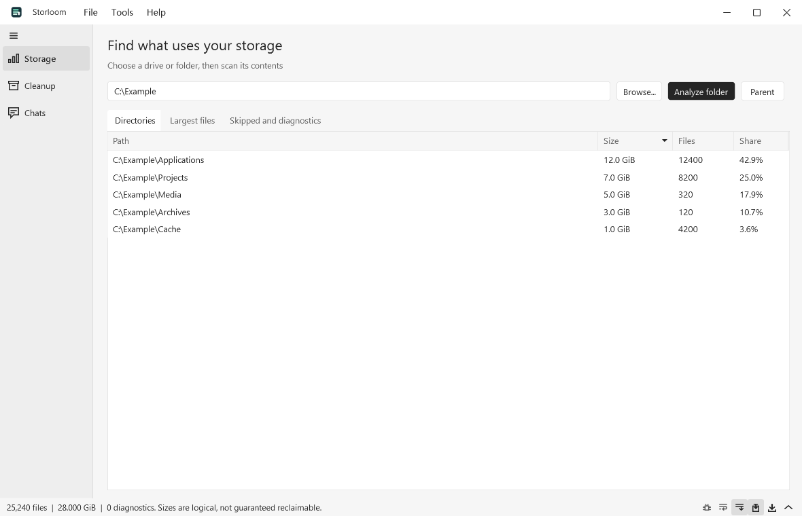
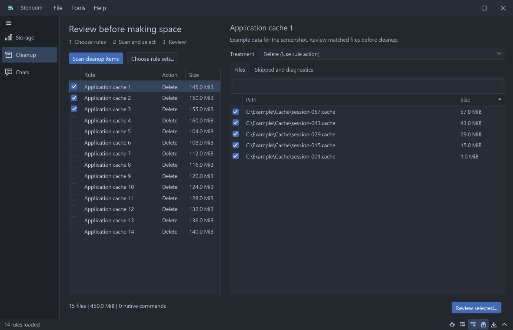

# Storloom

A Windows storage manager for reviewing cleanup, archiving selected cache files, understanding disk usage, and keeping local QQ/WeChat archives. C# and WPF, English and Simplified Chinese.

[简体中文](README.zh-CN.md) · [Getting started](docs/quickstart.md) · [Rule reference](docs/rules.md) · [AI rule guide](docs/ai-rules.md) · [Chat compatibility](docs/chat-exporters.md)

## Screenshots

Screenshots use synthetic example data. No personal accounts or local scan results are shown.

Storage analysis in the light theme:



Cleanup preview in the dark theme:



## Run

Extract the Windows x64 package into a writable folder and run **Storloom.exe**. Windows 10/11 x64; the runtime is included. The application and chat exporters need no Python backend. `cli/Storloom.Cli.exe --help` lists CLI commands.

- **Cleanup and archive:** choose rule sets, scan, inspect and check items, then review exact operations before executing. Every item starts unchecked. For a file cleanup item, choose the rule's action, archive while retaining originals, or archive then remove originals. Copy/move is part of the cleanup workflow; there is no separate GUI file mover.
- **Storage analysis:** scan a mounted local drive/folder, drill into directory totals, inspect the largest 100 files, and read diagnostics. Sizes are logical lengths, not a promise of physical reclaimable bytes; hard links, compression, and sparse files can differ.
- **Chat archives:** follow the account -> verified raw backup -> reading-copy steps. Raw backup needs no key and includes media. Supported databases export to JSONL and offline HTML with a completeness report. Previous verified backups are remembered privately.

Language, backup/archive destinations, and enabled rule sets live in **Tools > Preferences**. **Help > Getting started** (F1) explains each workflow. About shows version, developer, and the repository. The native WPF UI uses virtualized tables, a shared theme including the title bar, and throttled progress updates.

## Rules and native cleanup

`rules/sets.json` lists independently selectable rule sets. Windows, browser, and developer-tool categories are enabled by default; desktop utilities, regional application categories, and native cleanup recipes are optional. The GUI combines enabled sets with private `data/rules.json` overrides by ID. Imports merge into local overrides; they do not erase packaged sets. CLI supports `--sets ID,ID` or an explicit `--catalog FILE`.

AI can author data-only JSON using the [schema](rules/rules.schema.json) and [guide](docs/ai-rules.md). Import, scan, inspect actions and destinations, then confirm. There is no embedded AI service or automatic upload.

`Command` rules select reviewed application-owned recipes: NuGet HTTP cache, npm cache, pip cache, and uv prune. Executable, fixed arguments, and SHA-256 are previewed and revalidated. No arbitrary shell, script, or custom argument execution is accepted. Native cleanup acts on the tool's whole configured cache; per-file age/size/exclusion filters do not apply. The optional pip recipe invokes the user's existing Python. uv prune can also remove shared project environments. See [getting started](docs/quickstart.md) for scope, timeout, and cancellation details.

## Data boundaries

Nothing is cleaned on startup. Deletion bypasses the Recycle Bin and validates age, identity, paths, processes, link count, and plan lifetime. System/application components, credentials, broad roots, and user document locations are protected. Default settings permit ready fixed drives; restrict `allowedDrives` and `protectedRoots` for backup/other-system volumes. Those settings restrict file Delete rules, not explicitly chosen transfers or a native tool's own cache scope.

Unknown junctions/symlinks stay blocked. A relocated cache can be handled by private rules explicitly naming a verified physical cache leaf. Do not disable link checks globally or classify a whole app/profile/chat folder as cache.

Archive destinations must be new and non-overlapping. Selected files are copied and SHA-256 verified as a complete batch before any Move removes originals; each source/target pair is checked again before removal. Existing folders are not merged. File content, modification times, and empty directories (for full-folder backups) are preserved, not ACLs/alternate streams or a bootable system image. Interrupted partial directories and journals remain; automatic resume/merge is not implemented. Empty source directories remain after moves.

Chat backup/export never removes originals, creates junctions, or rewrites client storage settings. Readable export does not replace the raw archive or guarantee all contact names/media playback/client versions. Inspect incomplete reports and test restore separately with an appropriate client version. Keys stay in memory; process crashes can leave decrypted `.work-*` files in the chosen export folder. The optional WeChat login capture runs in an isolated signed-client worker; see [compatibility](docs/chat-exporters.md).

Paths must be canonical absolute drive paths. UNC is unsupported; mapped drives can be explicitly selected for analysis/transfers. No automatic elevation, scheduled cleanup, telemetry, or cloud AI is configured. Windows system SQLite provides read-only message queries.

Preferences, rule overrides, settings, scans, plans, error records, and journals live in executable-adjacent `data/` (or an explicit `Storloom.exe --data-dir DIRECTORY`). They can contain private paths. Backups/exports are also private and reading copies are plaintext. These files are excluded from Git and release packaging. Public product attribution is intentional; workstation paths/account records are not distributed.

## Build

Install .NET 10 SDK on Windows. The baseline rolls forward within .NET 10 feature bands. An optional ignored SDK in `artifacts/toolchain/dotnet/` is discovered through relative `global.json` paths; this feature requires a .NET 10+ host. With no isolated SDK, the system installation is the fallback.

```powershell
dotnet build Storloom.sln -c Release
dotnet test Storloom.sln -c Release
./scripts/Publish.ps1 -Version 0.6.3
```

The package script copies only public binaries, rules, documentation, and notices into a fresh directory, audits local identity paths, and emits ZIP/SHA-256. It never copies `data/` or test fixtures. CI builds/tests on Windows; the packaging workflow creates artifacts without publishing a GitHub Release. The icon source is SVG; `scripts/Build-Icon.ps1` regenerates the multi-size Windows ICO.

Tests cover identity/boundary guards, copy/move/archive verification, native-recipe tampering/output/cancellation/timeout using a separate test executable, synthetic encrypted chat/WAL data, a complete verified-backup GUI export, locale parity, and bilingual page/dialog rendering. Fixture tests do not certify every real client version, login capture, or restorability.

MIT. See [third-party notices](THIRD-PARTY-NOTICES.md) for the adapted WeChat capture component and ZstdSharp. Exact .NET runtime license/notice files accompany self-contained packages.

## Appearance, progress, and reading archives

Preferences offer Light and One Dark Pro themes and 1, 2, or 4 chat database workers. Prefer 1 on a hard drive and try bounded parallelism on an SSD. Operations show phase progress, throughput, estimated remaining time when a denominator is known, and a collapsible local log. The WPF frontend uses virtualized tables. Drag the log divider to resize it; manual scrolling or selecting text pauses following. Toggle Follow latest or press Ctrl+Shift+L to resume/pause. Color and panel transitions are brief; Preferences can reduce motion.

Account sizes include databases, images, video, and attachments. Reading archives provide named conversations, chronological 300-message pages, search within the current page, and recognized local media. The embedded viewer needs Microsoft Edge WebView2 Runtime; the same messages.html works offline in a browser with its adjacent assets. Names fall back to IDs when contact metadata is unavailable. WeChat XOR, validated V1, and V2 JPEG/PNG/GIF/WebP images can be decoded when the required local configuration is available. Packed media references improve image/video matching. WxAM/HEVC images, missing local assets, SILK voice and unsupported schemas still have explicit placeholders; the raw backup remains authoritative.

Native cleanup rules can measure tool-discovered directories or explicit directory roots. Results show each deletion's processed logical bytes and each native command's before/after difference. Unknown or partial measurements are not reported as zero. See the rule reference for configuration.

## Desktop themes and message cards

The main frontend uses WPF and WPF UI 4.3.0; WebView2 is only initialized for the offline conversation reader. The light theme uses grayscale, and One Dark Pro covers native controls, menus, dialogs, and the custom title bar. Preferences support a validated JSON color override file, reduced motion, and persisted sidebar/log dimensions. See [themes](docs/themes.md).

New reading exports derive typed message parts for WeChat and NTQQ, retain mixed-segment order, and collapse all original payloads behind View original content. Quotes, payments, media, files, cards, locations, forwarding and system records have display cards or explicit placeholders. Unsupported message counts and missing/unsupported media are reported separately. This does not promise recovery of unavailable assets or compatibility with every client schema. See [message coverage and research](docs/message-display.md). Existing exports keep their existing reader files; re-export a verified raw backup to use the updated parser.

The close button can hide the app to its notification icon when enabled in Preferences. Tasks continue while hidden; use the icon to restore the window or exit. Closing during a task asks for confirmation, and a confirmed exit waits for cancellation to finish.

The reading toolbar offers Default, WeChat and QQ color schemes, each with light and dark variants. Scheme choice is remembered separately from brightness. Chat bubbles, quoted blocks and original-content bubbles use compact padding.

The desktop preview supplies the current reader interface for existing exports without changing their files. Re-export is needed for new parsing or to refresh standalone HTML.
