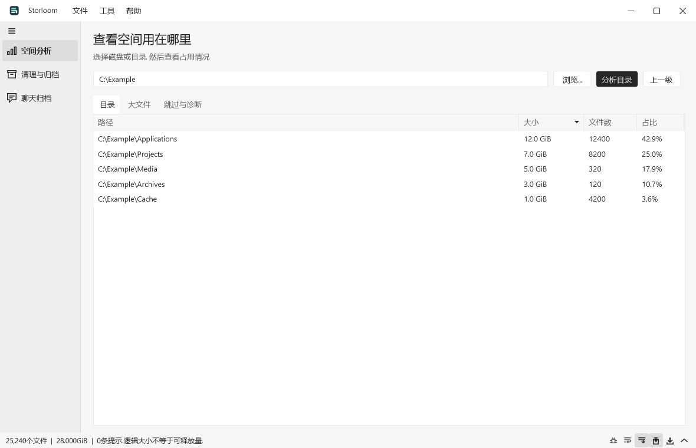
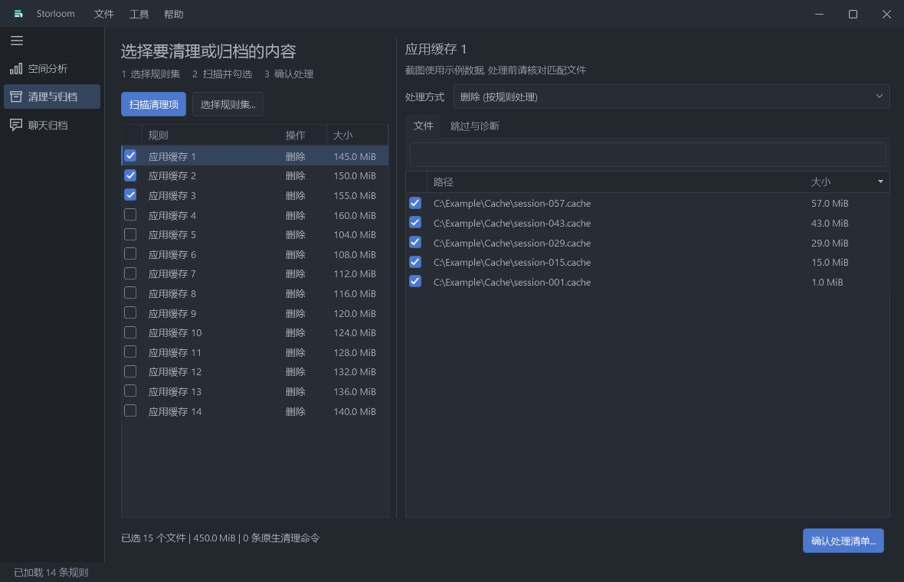

# Storloom

用于审核清理、归档缓存、分析存储空间、保存聊天客户端聊天备份的Windows工具。C# / WPF实现，支持中英文。

[English](README.md) · [快速上手](docs/quickstart.zh-CN.md) · [规则参考](docs/rules.zh-CN.md) · [AI规则指南](docs/ai-rules.zh-CN.md) · [聊天兼容性](docs/chat-exporters.zh-CN.md)
[归档库](docs/archive-library.zh-CN.md)

## 界面示例

截图均使用专门生成的示例数据，不展示个人账号或本地扫描结果。

浅色主题下的空间分析：



深色主题下的清理预览：



## 使用

解压Windows x64包到可写目录，运行 **Storloom.exe**。支持64位Windows 10/11，包内带运行时。软件本身和聊天导出不依赖Python后端。命令行入口为`cli/Storloom.Cli.exe`。

- **清理与归档**：选择规则集、扫描、检查并勾选项目，再审核处理清单。默认不勾选任何项目。文件项可以按规则处理、归档并保留原件、归档后移除原件。归档属于清理流程，不再单独放置文件移动页面。
- **空间分析**：扫描磁盘或目录，逐层查看大小、最大的100个文件以及诊断。显示逻辑大小，不保证等于实际可释放空间，硬链接、压缩和稀疏文件会影响统计。
- **聊天归档**: 分别管理账号及其存储位置. 可直接从本地资料建立阅览版, 也可独立备份用于还原的原件. 新账号默认推荐紧凑存储, 仍可选择普通文件夹. 紧凑归档可在程序内阅读和搜索, 也能导出便携 HTML 阅览版. 参见[紧凑存储说明](docs/compact-archives.zh-CN.md).

语言、浅色或深色(OneDark)主题、聊天解析并发数、备份位置、归档位置、启用的规则集在“工具 -> 首选项”中设置。F1或“帮助 -> 使用帮助”提供分步说明。关于页面展示版本、开发者和GitHub仓库。界面使用WPF虚拟化列表、统一主题和小圆角控件。操作时可查看当前阶段、处理吞吐、预计剩余时间及可收起的日志。帮助提供标题和分步排版。

## 规则与原生清理

`rules/sets.json`列出独立规则集。默认启用Windows、浏览器和开发工具类别，其他桌面工具、地区软件类别和原生清理命令按需启用。界面合并已启用规则集与本地`data/rules.json`，相同ID由本地覆盖。导入合并到本地规则，不清空其他规则集。CLI可通过`--sets ID,ID`选择，或通过`--catalog FILE`指定目录文件。

AI可按[JSON Schema](rules/rules.schema.json)和[规则指南](docs/ai-rules.zh-CN.md)生成数据规则。导入、扫描、核对动作和目标，最后确认。没有内置AI账号或云端上传。

`Command`规则选择程序内已审核的原生命令：NuGet HTTP缓存、npm缓存、pip缓存和uv prune。扫描预览实际程序、固定参数和SHA-256，执行前再次核验。不支持任意Shell脚本或额外参数。扫描会通过固定只读命令查询缓存目录并统计大小，也可在规则中显式配置物理目录。清理结果展示每项释放大小，原生清理使用执行前后完整扫描的差值，未知或不完整统计不会计入合计。命令作用于原工具配置的整个缓存，不使用文件级时间、大小和排除筛选。可选pip规则使用已安装的Python，uv prune还可能移除共享项目环境。超时、取消和详细范围见[快速上手](docs/quickstart.zh-CN.md)。

## 数据边界

启动时不清理。文件删除不经过回收站，执行前检查身份、路径、时间、进程、链接数量和计划有效期。保护系统组件、程序目录、凭据、过宽根目录和用户文档目录。默认允许就绪固定磁盘；可通过`allowedDrives`、`protectedRoots`保护备份盘和其他系统盘。这两项限制文件删除规则，不是全局磁盘策略，也不限制原生工具自身配置的缓存范围。

未知目录联接和符号链接仍会被阻止。已经转存的缓存应通过本地规则明确指定核实过的物理缓存子目录，不放宽全局链接检查，也不把整个软件配置、账号或聊天目录当成缓存。

归档目标必须是新的、互不嵌套的目录。先完整复制并核验所选文件的SHA-256，再按迁移方式移除原件，每次移除前重新检查两端内容。不会合并已有目录。保存文件内容、修改时间及完整目录备份中的空目录，不保证NTFS权限、备用数据流或系统镜像恢复。中断时保留部分副本和日志，不自动续传或合并；迁移后空源目录保留。

聊天流程不删除原件，不创建联接，不改客户端路径。阅读导出不能替代原始备份，不保证所有联系人备注、媒体播放或客户端版本。查看不完整报告，并使用对应客户端在独立目录测试恢复。密钥不会自动保存，进程崩溃可能留下临时解密文件。聊天客户端登录获取通过独立的签名客户端辅助进程执行，具体见[兼容性说明](docs/chat-exporters.zh-CN.md)。

路径须为规范盘符绝对路径，不支持UNC；映射盘可显式用于分析或迁移。程序不配置自动提权、定时清理、遥测或云端AI。消息查询使用Windows系统SQLite。

偏好、规则覆盖、设置、扫描、计划、错误记录和日志保存在程序旁的`data/`中，也可使用`Storloom.exe --data-dir DIRECTORY`指定。这些内容可能含有个人路径。原始备份和明文阅读版同样属于私有数据，Git和发布包均排除。公开产品署名与本机路径、账号记录分开处理。

## 开发与发布

Windows上安装.NET 10 SDK。版本在.NET 10范围内滚动选择。也可使用被忽略的`artifacts/toolchain/dotnet/`隔离SDK，`global.json`先按相对路径发现，再回退系统安装；该发现机制需要.NET 10或更新宿主。

```powershell
dotnet build Storloom.sln -c Release
dotnet test Storloom.sln -c Release
./scripts/Publish.ps1 -Version 0.6.8
```

脚本按白名单打包程序、规则、文档和许可证，检查本机路径，生成ZIP和SHA-256，不复制私有数据或测试夹具。CI在Windows执行构建和测试，打包工作流只生成产物，不自动创建GitHub Release。图标源为SVG，`scripts/Build-Icon.ps1`可生成Windows多尺寸ICO。

测试覆盖文件身份与边界、核验归档、隔离子程序的命令篡改与超时取消、合成聊天数据和WAL、中英文页面与对话框，以及从已核验备份完成GUI导出。夹具不代表全部真实客户端、登录获取或恢复兼容性已验证。

MIT许可证。第三方组件与运行时许可见[第三方声明](THIRD-PARTY-NOTICES.md)。

## 原生界面与消息卡片

主界面改用WPF与WPF UI 4.3.0。浅色使用白灰黑，One Dark Pro覆盖控件、菜单、对话框和自定义标题栏。WebView2仅在打开离线聊天阅读器时启动。首选项支持JSON颜色配置和减少动效，侧栏与日志尺寸会保存在本地。详见[主题配置](docs/themes.zh-CN.md)。

日志分隔线可拖动调整高度。手动滚动或选择日志文字后停止自动跟随，点击跟随开关或按Ctrl+Shift+L恢复或暂停。悬停、按下、日志面板与进度使用短暂过渡。

新版导出按聊天客户端的不同结构生成消息卡片，保留混合消息顺序，原始内容默认折叠。引用、转账、媒体、文件、卡片、位置、合并转发及系统消息有对应展示或明确占位。报告分别统计未知消息与不可用媒体，不代表所有客户端格式或媒体均可恢复。详见[消息展示范围](docs/message-display.zh-CN.md)。旧阅读版不会自动替换文件，可从已核验的原始备份重新导出以使用新版解析。

首选项可将关闭按钮设为隐藏到托盘。隐藏期间任务继续执行，通过托盘图标可返回窗口或退出。任务运行时关闭会请求确认；确认退出后，会等待任务取消完成再结束程序。

阅读器顶部可选择多套聊天布局，每套支持浅色与深色，选择会单独记住。消息和辅助控件使用紧凑布局。

内置预览打开已有阅读版时会使用当前阅读界面，不修改导出文件。新解析或独立网页的更新仍需要重新导出。
