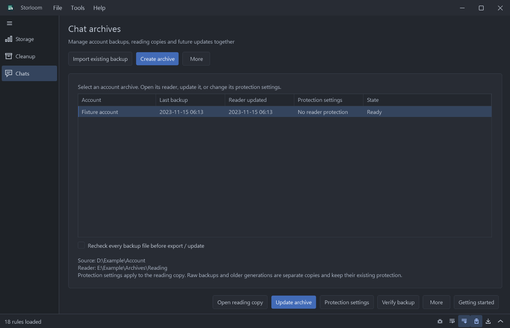

# Getting started

## Account archives

Open Chats to select an account archive. **Create archive** provides initial setup; **Import existing backup** registers an existing verified backup. Daily actions are **Open reading**, **Update archive** and **Protection settings**. The list shows the backup time, reader time and current reading protection separately.

Update checks source changes, creates a verified backup, updates the reader and applies the saved protection rules. Pause retains the running task; Cancel stops work while preserving its checkpoint. **Continue update** resumes the captured backup, so changes made after that snapshot require another update. More actions include backing up originals only, rebuilding from the verified backup and abandoning a pending task without deleting its backups or workspace.

Before starting or continuing an update, the connection page groups **Recheck every backup file before export / update** with the worker setting. Disable it to skip the repeated full SHA-256 pass. After completion, **Verify backup** runs that pass independently without a password or another export. Structural, size, database authentication and transfer verification checks remain active. Unfinished tasks retain their verification choice; change it on the connection page before continuing if needed.

Workspace preparation first counts files and bytes, then copies and verifies with the selected worker count. The status shows the archive stage, file counts, processing bytes, speed and an estimate for the current phase. Counting has no known total yet; estimates do not include later phases. Copy/restore and encryption bytes include their verification pass, rather than only the final archive size. Completed workspace files are checked and reused on continuation. Drag the log divider to set its expanded height; it is saved immediately and reused for later tasks and application launches.

The log toolbar has independent toggles for opening on task start and collapsing after success. Both choices are remembered. Automatic collapse preserves log text and the chosen expanded height; failed or cancelled tasks keep the log open. Selected toolbar toggles also have a distinct hover shade.

Updates produce independent reading generations. The catalog switches only after verification. The previous reader remains readable and is retained, including any plaintext it already contained. **Protecting the new reader does not protect or remove older plaintext readers or raw backups.** Handle those copies separately.

Protection is a lasting archive setting. Full protection includes matching new content. Saved conversation, type, sender and content rules also match future messages; explicit message IDs select only those messages, subject to the displayed shared-page/resource scope. Strict scope keeps sanitized public pages. Passwords and captured database keys are never saved. Scope metadata is authenticated and encrypted in the vault.

Protected updates use a Windows EFS encrypted working directory on the backup volume. **The signed-in Windows account can access temporary restored data.** This protects files at rest from other accounts/offline access; it is not password isolation against software running as that same account. EFS must be supported and enabled; the task refuses a plaintext fallback. Keep enough free space. Fully protected, unchanged media can be authenticated and reused as ciphertext without restoring a second plaintext media copy. Other transformations still need working space.

A protection change also creates a new reader generation. Removing protection deliberately publishes plaintext and requires confirmation. Existing protected readers keep the same password during update. Old generations are not automatically deleted. Keep the EFS certificate/key recoverable if you need to resume an interrupted protected workspace after reinstalling Windows.

Storloom starts on **Cleanup and archive**. Nothing is cleaned on startup. Press F1 for contextual help; open Tools > Preferences to choose language, archive/backup destinations, and rule sets. File > Open local data opens private plans, custom rules, and records. Help > About shows version, developer, and the repository.

## Clean or archive caches

1. Open Preferences > Rule sets and enable only the software categories you need.
2. Click Scan cleanup items. Select an item on the left; inspect its files and diagnostics on the right.
3. Check the items to process. Uncheck individual files to retain them. Every item starts unchecked.
4. For a file item, choose its Treatment: the rule's action, Archive and keep originals, or Archive then remove originals. The archive destination is set in Preferences.
5. Click Review selected. The review shows exact actions, destinations, source samples, and any native commands. Confirm and execute is the mutation boundary.

Archive copies only the selected matches, not the whole source folder. Each rule/root gets a new directory. SHA-256 verification finishes before a move starts removing originals; both sides are checked again for each removal. Existing destinations are not merged. Copy does not reclaim source space. Permanent deletion bypasses the Recycle Bin.

## Use a tool's own cleanup

Enable Application cleanup commands. Supported recipes are NuGet HTTP cache, npm cache, pip cache, and uv prune. Install the relevant tool first or set its private executable path in `data/settings.json` under `toolPaths` (keys: dotnet, node, python, uv). The application and chat exporters require no Python; the optional pip recipe invokes your existing Python installation.

Scan previews the executable, fixed arguments, and executable SHA-256 without cleaning. Review the command before confirming. Native commands apply to the tool's whole configured cache, so per-file exclusions and age/size filters do not apply. Choose either a file rule or a native rule for the same cache; running both can make the later operation find no files. uv prune may also remove shared project environments, which can need rebuilding. There is no arbitrary shell/script execution. Timeout defaults to 300 seconds (`commandTimeoutSeconds`, 1..3600). Cancellation/timeout ends only the child process tree started for that command; tool changes already completed are not rolled back. Output and exit status remain in private records.

## Chat backup and export

Select a complete account directory in Chats. Close the source client and create a verified raw backup. Existing verified backups can be reopened without copying the account again.

Encrypted backups require a matching database key. Read one from a logged-in client, explicitly start the separate login-capture flow, enter a retained key or load a key file. Follow the client-close and login instructions. The verified-key menu supports explicit copy/export; keys are never saved automatically. Store plaintext key files separately and securely.

Export settings can enable password protection after finalization; unfinished exports remain plaintext. Resume continues the same immutable backup. Update reading copy merges a newer backup. Keep raw data and manifests. See [chat backups](chat-exporters.md) and [password protection](chat-encryption.md).

## Debugging and exporting logs

Enable **Debug logging** in the operation log toolbar or Preferences before retrying a problem. It adds scan totals, candidate authentication counts, capture stages, timings, runtime version and exception stacks. Captured keys, password input and chat bodies are excluded from diagnostic records. The choice persists; disabling it stops additional diagnostic entries and leaves earlier entries available.

Use the export icon next to the log collapse button, or File > Export log, to save a UTF-8 text snapshot. Export is available during a task and while its log is collapsed. It includes the retained operation history beyond the shorter on-screen tail. Logs stay in memory until exported or the operation is restarted; the retained export tail is limited to 16 Mi characters, and the file header identifies dropped earlier entries. Existing normal log lines can include local file paths. Export never uploads a log.

## Relocated caches

Unknown junctions and symlinks remain blocked. If a cache was relocated, inspect its link target and add a private file rule for the verified physical cache leaf. Do not point a rule at a whole profile, Steam HTML profile, app settings, chat account, or application directory. For example, a Steam renderer cache is disposable while its neighboring Local Storage and Network folders can contain sessions. Local rules are merged by ID over enabled sets, and remain private.

## Progress and results

The operation area shows phases, throughput, estimated remaining time when a total is known, and a collapsible log. An unknown-size scan stays indeterminate. Copy work includes writes and verification reads, so its work-byte total exceeds source size. Cancellation preserves completed work and journals. Results list released logical bytes per cleanup item; native tools show complete before/after scans, with unknown values excluded from totals.

## Conversation reader

Use Open reading archive after export, or File > Open reading archive to select messages.html. Search conversations on the left, read sender-labelled bubbles on the right, and move through chronological configurable message pages. Message search covers the current page. Move the entire reading directory, including its JS/CSS, conversations, and assets. The embedded viewer needs Microsoft Edge WebView2 Runtime; a browser can open the same HTML offline.

Contact names prefer remarks, nicknames, aliases, then IDs when supported metadata is available. Recognized local images, legacy XOR image containers, and browser-supported local media can be shown. New encrypted images requiring a separate key, unsupported resource indexes, SILK voice, and unsupported contact tables remain visibly unavailable. Reading copies do not replace raw backups.

To upgrade an old reading export, reopen its verified raw backup sidecar and export into a fresh directory. The original account need not be copied again. Prefer 1 database worker on a hard drive; try 2 or 4 on an SSD. Export reports include phaseSeconds for full backup verification, database work, and reader indexing.

## Reading and appearance

Reading copies use conversation navigation, typed cards, missing-media placeholders and collapsed original content. Re-export a verified raw backup to apply the new parser to an old reading copy. See [message coverage](message-display.md).

Drag the log divider to resize. Manual scrolling or selection pauses following; the switch or Ctrl+Shift+L toggles it. Preferences offer monochrome Light, One Dark Pro, reduced motion and optional custom JSON colors. See [themes](themes.md).

## Rule-set library and compact controls

Preferences > Rule sets shows the name, source and catalog filename of each set. Import rule set accepts a version-1 rule catalog JSON. Imports stay in private data/rule-sets, separate from the installed catalogs. Check the sets you want, then Save settings. Removing an imported set removes it from the library on save; its stored catalog is retained. Cancel discards library changes. Packaged sets can be disabled. Duplicate rule IDs across selected sets are rejected; use local overrides when replacing an existing rule. Importing never scans or executes rules.

The sidebar menu icon switches between labels and icons; each icon has a tooltip. Drag its boundary to change width. Tables show a sort arrow in the active column. Click the header to reverse direction; size columns compare byte counts rather than formatted units.

While an operation runs, its initiating button becomes Cancel in the same location. The log can be collapsed with its chevron and resized using the thin divider. Normal logs follow the interface language. Debug entries use aligned ASCII English fields and escape non-ASCII paths. Existing history is retained when debug logging is disabled.

Find accounts searches common chat clients locations and registered chat clients storage paths. A selected or known root containing a directory link is resolved to its physical local location; nested links remain excluded. If none are found, the page says so. Use Choose account folder for another location, selecting the complete account directory rather than an individual database or media subfolder.

Right-click a table header to fit that column, fit every resizable column, or restore the original widths. Hover a table cell to read its full value. Double-click a row in a checklist to toggle its checkbox; directory rows in storage analysis still open that directory. Icon actions have tooltips and no visible border.

Tilt-wheel horizontal scrolling targets the scrollable pane under the pointer, including tables and the operation log. Windows horizontal-wheel character/page settings and partial wheel deltas are respected. Manually scrolling the log horizontally also pauses following. Sidebar expansion and collapse use the same short transition as the log and respect Reduce motion. The log/status bar is visible at startup and is the sole bottom status surface.

## Incremental chat workflows (1.0)

After the initial full backup, choose **Incremental backup…** in the backup step. Storloom remembers the previous verified backup or asks you to select its manifest. Close the client first. A new generation copies and verifies new/changed files; unchanged resources reference their existing verified physical copies. Databases and their WAL/SHM files are copied together into every generation. Source file identity, size and modification time determine reuse; enabling export-time verification rehashes all referenced bytes. **Keep every raw generation and its manifest together** when moving or copying the backup set. A generation is not a standalone folder and deleting an older raw generation can break newer ones. Full backups and ordinary transfers retain their existing behavior.

Select the new backup, obtain its matching database key if needed, then choose **Update reading copy…** and select your existing completed reader of the same account. This merges new/edited messages, retains history no longer present in the client, reuses local media and rebuilds only affected conversation pages. Unchanged databases are skipped by their verified database/WAL fingerprints. Message identity uses server ID, then sequence with sender/time; messages without a reliable ID use a payload fingerprint. Edited payloads without stable IDs are preserved as additional history. First adoption builds a disk-based deduplication index by scanning JSONL once; future updates reuse it. A changed database still needs decryption and parsing, and an update with changes streams the existing JSONL to merge history. It avoids resolving every old attachment again; it does not promise instantaneous updates or recover expired/absent resources automatically.

Cancel before publication leaves the existing reader intact. Files are staged and published with rollback data; an interrupted publication is recovered before the next update. Close that reading window while updating. The JSONL, derived index and changed pages require working space in the reading directory. Back up important reading copies separately. **Resume export** instead continues an interrupted export of the *same* immutable backup, rather than merging a newer backup. Update reports record added, changed, unchanged messages and affected conversations. Existing resource/completeness reports remain conservative when a prior export was incomplete.

## Persistent logs and parallel work

The bottom log bar is always present and collapses to a compact status line. Its icons provide pause, cancel, debug, wrapping, follow, automatic opening, export and collapse actions, with tooltips. Follow starts enabled. Disable automatic opening to keep new tasks from expanding the panel. Wrapping and automatic-opening choices are remembered; new tasks retain history.

Backup, incremental backup, export and encryption accept 1-8 workers. Copy and verification can run concurrently; publication and source removal retain their safety order. Disk type, file sizes, caches and media affect performance, so more workers may be slower. Retained key files have no required filename or extension; exported contents are still plaintext.

Workers default to Auto. The task and target volume seek behavior determine the recommendation, bounded by CPU count and available memory; the selector shows the current recommendation and still accepts manual values from 1 to 8. Unknown storage uses a conservative fallback. These are estimates, not guaranteed optimal settings under every disk load.

Each file/folder picker remembers its directory by purpose. Reading copies remember appearance and page/navigation choices independently. New copies initially match their source style and the application's brightness; later choices take priority. The page-size preset menu always lists every preset, with custom numeric entry alongside it. Protected reader preferences contain only presentation choices, not message text or passwords.

## Archive library

Chat archives > Archive library offers optional import of completed reading copies, direct indexed reading and search, incremental pack backup, password changes, verification and compatible export. See [Archive library](archive-library.md) for recovery and protection limits.
