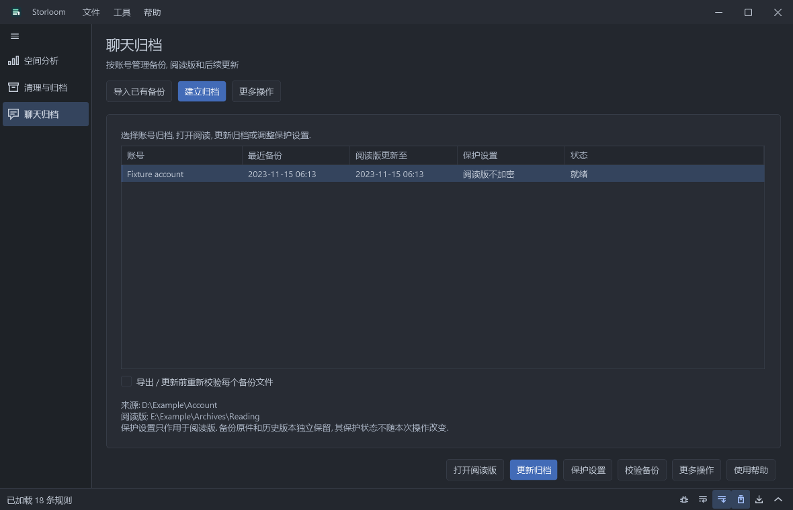

# 快速上手

选择账号后可独立创建阅览版或原件备份, 无需先备份再导出. 自动账号搜索及客户端位置可在账号页面或首选项配置. 密钥库与原件恢复入口位于聊天归档的更多操作. 参见[聊天备份与导出](chat-exporters.zh-CN.md).

## 按账号管理归档

进入聊天归档后选择账号. **建立归档**提供首次设置, **导入已有备份**用于接入已经核验的备份. 平时使用**打开阅读**, **更新归档**和**保护设置**. 列表分别显示备份时间, 阅读版时间和当前阅读版的保护状态.

更新会检查来源变化, 建立经过校验的备份, 更新阅读版, 再应用保存的保护规则. 暂停保留当前运行任务; 取消会停止处理并保留检查点. **继续更新**使用已经捕获的那次备份, 之后发生的来源变化需再发起一次更新. 更多操作包括只备份原件, 从已验证备份重建阅读版, 以及放弃未完成任务. 放弃不会删除其备份或工作区.

开始或继续更新前, 连接归档页面将 **导出 / 更新前重新校验每个备份文件** 开关与工作线程数放在一起, 按归档记住选择. 关闭可跳过重复的完整 SHA-256 校验. 完成后点击 **校验备份** 可独立执行一趟完整校验, 无需密码, 也无需再次导出. 结构、文件大小、数据库认证及传输校验仍保留. 未完成任务保留校验选择, 也可在连接归档页面修改后继续.

工作区准备会先清点文件数及数据量, 再按所选线程数复制并校验. 状态栏显示归档阶段、文件数、处理数据量、速度及当前阶段的预计剩余时间. 清点时总量尚未确定, 剩余时间不包含后续阶段. 复制 / 还原和加密的数据量包含校验这一趟处理, 并非最终归档大小. 继续任务会检查并复用已完成的工作区文件. 拖动日志栏分隔线可调整展开高度, 立即保存并在后续任务及重启软件时恢复.

日志工具栏分别提供新任务自动展开、成功结束自动收起的图标开关, 并记住选择. 自动收起保留日志文本及设置的展开高度; 失败或取消的任务保留日志展开. 选中的图标按钮悬停时也有明确的颜色变化.

更新会生成独立阅读版本, 校验完成后才切换归档指向. 原阅读版仍可读取并会保留, 包括其中原本存在的明文. **新阅读版加密不会保护或移除历史明文阅读版, 也不会加密备份原件.** 这些副本需要单独处理.

保护方式作为归档的长期设置保存. 全部保护会包含新增内容. 会话, 类型, 发送人和内容规则会继续匹配以后新增的消息; 指定消息 ID 只选择这些消息, 仍受界面说明的共享页面和资源范围影响. 严格模式保留经过清理的公开页面. 密码和捕获的数据库密钥不会保存. 范围规则经过认证并加密保存在保护数据中.

加密更新使用备份所在卷上的 Windows EFS 加密工作目录. **当前登录的 Windows 账户仍可访问临时还原内容.** 这保护文件不被其他账户或离线访问直接读取, 不能隔离以同一 Windows 账户运行的软件. EFS 必须可用且已启用; 不支持时停止, 不会回退到普通明文目录. 请预留足够工作空间. 全部保护模式下, 未变化媒体可以校验后复用密文, 不再还原第二份明文媒体; 其他处理仍需要工作空间.

调整保护方式也会生成新阅读版本. 取消保护会明确生成明文并要求确认. 已加密阅读版更新时使用原密码. 不会自动删除历史版本. 如果需要在重装系统后继续未完成的加密工作区, 请同时妥善保管该 Windows 账户的 EFS 证书和密钥.

打开软件后进入“清理与归档”。程序不会在启动时清理。按F1查看当前功能的帮助；从“工具 -> 首选项”设置语言、主题、聊天解析并发数、备份位置、归档位置和规则集。“文件 -> 打开本地记录”可查看私有计划、规则和日志。“帮助 -> 关于”展示版本、开发者及GitHub仓库。

## 清理或归档缓存

1. 在“首选项 -> 规则集”中勾选你使用的软件类别。
2. 点击“扫描清理项”。选择左侧项目，在右侧检查文件和诊断信息。
3. 勾选需要处理的项目，取消勾选要保留的文件。扫描后不会自动勾选。
4. 在“处理方式”中选择按规则处理、归档并保留原件、归档后移除原件。归档位置在首选项中设置。
5. 点击“确认处理清单”，核对每项动作、来源、目标和命令，再点击“确认执行”。

归档只包含命中且勾选的文件，不等于完整目录备份。程序为每个规则和来源创建新目录，完成整批SHA-256核验后才会开始移除源文件，并在每次移除前重新检查两端内容。已有目录不会被合并覆盖。“保留原件”不会释放源空间；删除不经过回收站。

## 使用软件自己的清理功能

在首选项中启用“软件自带清理”。目前提供NuGet HTTP缓存、npm缓存、pip缓存、uv过期缓存四种原生命令。需先安装相应工具；也可在本地`data/settings.json`的`toolPaths`中配置dotnet、node、python、uv的实际程序路径。软件本身和聊天导出不需要Python，只有可选的pip原生清理会调用已安装的Python。

扫描仅检查程序并生成预览。确认页会显示实际程序、固定参数和整缓存范围，不执行AI给出的任意Shell脚本。原生清理不支持逐文件排除，也不受文件规则的年龄和大小筛选限制。同一缓存选择文件清理或原生清理中的一种，避免重复处理。

uv prune还可能移除共享项目环境，再使用时需要重建。命令默认超时300秒，可在本地设置`commandTimeoutSeconds`，范围1至3600。取消或超时会结束本次启动的工具进程树，已经由工具完成的变更不会回滚。输出和退出状态保存在本地记录中。

## 聊天备份与导出

在“聊天归档”中选择完整账号目录，退出源聊天客户端后建立原始备份。核验完成即可导出，无需重新复制已备份的账号目录。

加密备份需提供匹配的数据库密钥。可以从已登录客户端只读获取，也可主动选择专用登录获取流程，按提示退出日常客户端并在新窗口登录。已保管的密钥可手动输入或从文件载入。“查看／保管已验证密钥”支持主动复制和导出，程序不会自动保存密钥。请将明文密钥文件单独安全保管。

导出设置可选择完成后密码保护，未完成导出仍保留明文。继续同一备份的中断任务使用“继续上次导出”；合并更新的备份使用“更新阅读版”。始终保留原始备份和清单，阅读版不能替代原始数据。参见[聊天备份说明](chat-exporters.zh-CN.md)和[密码保护](chat-encryption.zh-CN.md)。

## 已转存的缓存

未知目录联接和符号链接仍会被阻止。已经转存的缓存，应核实链接目标后，为真实缓存子目录建立本地规则。不要把整个用户配置、Steam网页配置、软件设置、聊天账号目录当成缓存。Steam的渲染缓存可以重建，旁边的Local Storage、Network等目录可能包含登录状态。本地规则会按ID覆盖已启用规则集中的同名项目，只保存在本机。

## 查看进度和清理结果

任务开始后，底部显示当前阶段、吞吐和预计剩余时间。没有已知总量的目录扫描只显示活动状态，不编造百分比或剩余时间。复制的处理量包含写入和核验读取，因此是源文件逻辑容量的两倍；日志会同时说明源容量和总处理量。日志可展开或收起，取消不会撤回已经完成的操作。

完成清理后，结果窗口按项目展示处理方式和释放的逻辑大小。原生命令还会展示清理前、清理后容量；统计失败时显示未知，不当作零。缓存被其他程序继续写入时，净差值可能为负数。

## 使用会话阅读版

完成后选择“打开阅读版”，也可从聊天归档入口打开已有普通或加密阅读版。左侧选择会话，右侧阅读、搜索和查看原始内容。每页消息数可自行设置；更多消息会增加内存和渲染开销。搜索范围可选当前会话或整个归档，支持返回搜索结果。导航预览可以收起或关闭。

图片可点击预览、缩放、旋转、复制及另存。头像和姓名可打开资料，点击会话标题查看会话详情。资源缺失会明确提示，不代表备份原始数据被删除。移动阅读版时请一起保留目录全部内容。加密阅读版必须使用内置阅读器打开，并保留标记文件及完整密文目录。

机械硬盘建议先用一个工作线程，固态盘可尝试两个或四个；实际吞吐量受磁盘、资源及客户端格式影响。详细展示范围见[消息展示](message-display.zh-CN.md)。

## 阅读与界面设置

阅读版按会话浏览，引用和媒体使用相应卡片。找不到资源会显示占位，原始内容默认折叠，点击“查看原始内容”可展开。旧阅读版需从原始备份重新导出以使用新解析。详见[消息展示范围](message-display.zh-CN.md)。

日志可拖动分隔线调整高度，手动滚动或选择文字暂停跟随，开关或Ctrl+Shift+L可恢复或暂停。首选项中可选择白灰黑浅色主题、One Dark Pro、减少动效和自定义颜色文件，详见[主题配置](themes.zh-CN.md)。

## 调试与导出日志

在日志栏或首选项开启“调试日志”后再重试问题，可看到扫描量、候选认证次数、登录获取阶段、耗时、运行时版本与异常堆栈。诊断记录不包含捕获的密钥、输入的密码或聊天正文。开关会保存；关闭后停止新增调试记录，之前的记录仍可导出。

点击日志收起按钮旁的导出图标，或“文件 → 导出日志”，保存UTF-8文本快照。任务执行中和日志收起时都可导出；内容包含比屏幕滚动区域更长的当前会话历史。日志保留在当前会话内存中，新任务不会清空历史；关闭程序前可主动导出；导出历史上限为16 Mi个字符，文件头会说明是否丢弃了更早条目。原有普通日志可能包含本地文件路径，导出不会上传日志。

## 规则集列表与紧凑布局

“首选项 -> 规则集”展示各规则集的名称、来源和文件名。“导入规则集”接受版本为1的规则目录JSON。导入内容保存在私有的data/rule-sets目录，与安装包提供的规则分开。勾选所需规则集后保存设置。移除导入项会在保存时将其移出列表，但保留已存储的规则文件；取消设置会放弃列表修改。随程序提供的规则集可以停用。所选规则集存在重复规则标识时会拒绝加载，替换现有规则应使用本地覆盖配置。导入不会触发扫描或执行。

侧栏顶部的图标按钮切换文字与图标布局，图标悬停时显示功能名称，边界可拖动调整宽度。列表按当前排序列显示箭头，点击表头可反向排序；大小列比较原始字节数，不按单位文字排序。

任务执行时，发起任务的按钮在原位置变成“取消”。日志区域可通过箭头图标收起，细分隔线可拖动调整高度。普通日志随界面语言切换；调试记录使用对齐的英文 ASCII 字段，非 ASCII 路径会转义，外部工具输出保留原文。

“查找账号”搜索聊天客户端的常见目录，以及聊天客户端注册的存储位置。指定目录或常见根目录经过目录链接时，会解析为实际的本地位置，仍然跳过其内部的其他链接。未找到时会在页面内提示。其他位置请使用“选择账号目录”，选择同时包含数据库和媒体的完整账号文件夹，而不是某个数据库文件或媒体子目录。

右键点击表头可自动调整当前列、所有可调整的列，或恢复原始列宽。悬停在列表单元格上可查看完整内容。双击勾选列表中的条目可切换勾选状态，空间分析中的目录仍通过双击进入。图标按钮不显示边框，悬停时显示功能提示。

滚轮左右拨动会横向滚动鼠标所指向的列表或日志区域，遵守系统的横向滚动字符数或整页设置，也支持不足一格的滚动增量。手动横向查看日志时会暂停自动跟随。侧栏展开、收起使用与日志相近的短动效，启用减少动效时直接切换。日志状态栏在启动时显示，是唯一的底部状态区域。

## 增量备份与更新阅读版（1.0）

首次使用完整备份。后续在备份步骤选择 **增量备份…**，应用会使用记住的已校验备份，或让你选择上次的备份清单。先退出聊天客户端。新代次复制并校验新增、变更文件；未变化的资源通过清单引用原有副本，数据库和 WAL/SHM 文件则在每个代次一起保存。是否复用依据源文件身份、大小和修改时间；导出前的重新校验开关开启时，会重新计算所有引用文件的哈希。**请保留所有原始备份代次及清单，迁移时一起复制。** 增量代次不是独立完整目录，删除旧的原始代次会使新代次缺少它引用的资源。普通完整备份、普通复制移动的行为不变。

选择新备份，必要时获取与其匹配的数据库密钥，再点 **更新阅读版…**，选择同账号已有的已完成阅读版。更新合并新增和变更消息，保留客户端已经清除的历史消息，复用本地资源，只重建受影响的会话页面。数据库及 WAL 指纹未变时直接跳过；消息优先用服务器 ID 去重，其次使用序号、发送人和时间，无稳定 ID 的消息按内容指纹区分，因此这类消息编辑后会保留为另一条历史记录。首次接入旧阅读版需扫描一次 JSONL 建立磁盘索引，之后复用索引。变更数据库仍需解密、解析，有消息变更时也需要顺序合并现有 JSONL；节省的是对旧消息和附件的重复解析、转换以及无变化页面的重新生成，不保证所有操作即时完成，也不会凭空恢复已过期或缺失的资源。

处理结果先写暂存区，发布前可取消，已有阅读版保留；发布期间出现异常会使用回滚数据，下次更新前恢复中断的发布。更新时请关闭这个阅读窗口，并为 JSONL、派生索引及受影响页面留出工作空间。重要阅读版仍应单独留备份。**继续上次导出** 是恢复同一份不可变备份的中断任务，**更新阅读版** 才是合并新备份。更新报告记录新增、变更、未变消息以及重建会话数；原有导出不完整时，完整性报告仍保守标记。

## 常驻日志栏与并行设置

底部日志栏从启动起常驻，折叠时仅保留紧凑状态行。图标支持暂停、取消、调试、自动换行、跟随、自动展开、导出及收起，悬停可查看说明。跟随启动时选中；关闭自动展开后，新任务不会弹出日志内容。换行和自动展开选择会记住。

备份、增量备份、导出和加密的工作线程可在 1-8 之间选择。复制与校验可以并行，发布和源文件移除仍保留安全顺序。不同磁盘、文件大小、缓存和媒体类型会影响收益，更多线程不保证更快。

保管密钥时文件名及后缀均可自行选择；写入内容仍是明文密钥。

工作线程默认为自动. 程序按任务和目标磁盘的寻道特性选择推荐值, 并受 CPU 数量和可用内存限制. 选择框显示当前推荐值, 也可手动选 1-8. 无法识别磁盘时使用保守值. 推荐值是估计, 不保证在所有磁盘负载下都最优.

文件及文件夹选择器按用途分别记忆目录. 各份阅读版独立记忆外观和页面导航选择. 新建时先采用归档来源的展示样式和软件的明暗设置, 之后以用户选择为准. 每页条数菜单完整列出预设, 也保留自定义数字输入. 加密阅读器保存的配置只包含界面选择, 不包含聊天文本或密码.

## 归档库

聊天归档 > 归档库提供可选的完整阅览版导入、直接索引阅读和搜索、数据包增量备份、修改密码、独立校验及兼容导出. 恢复方法和保护边界见 [归档库](archive-library.zh-CN.md).
